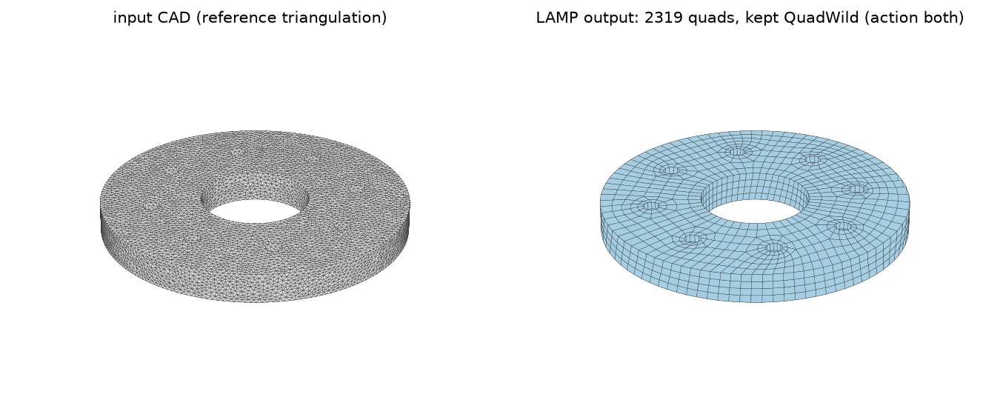
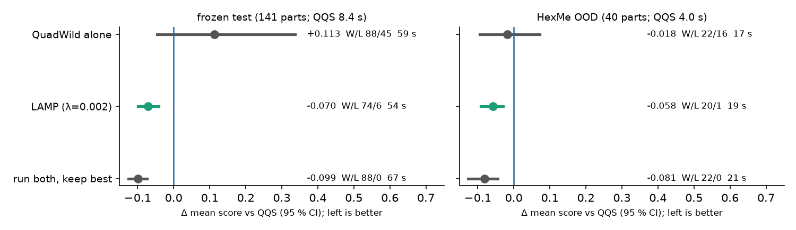
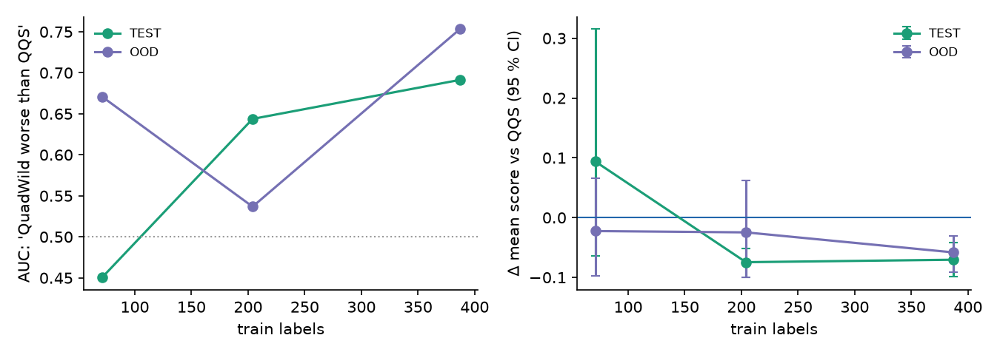

# LAMP: Learned Layout-Probe Controller for Quad Meshing of CAD Solids

LAMP runs QuadWild's cheap patch-layout stage as a probe, then a learned controller decides whether to finish
with QuadWild, switch to Gmsh QQS, or run both. On a leakage-free CAD benchmark at an equal element budget it
beats QQS in distribution and out of distribution, with few losses, and keeps CAD features.


*Input CAD part (left, reference triangulation) and LAMP's output (right). Made by `scripts/make_figures.py` with
`scripts/infer.py` on the generated test part `cad_models/flange_06`.*

## Key results

Frozen test set (141 CAD parts from ABC, a second public CAD collection and parametric parts; families never shared with
training) and an out-of-distribution set (40 HexMe parts, a different source never used for training or tuning).
Every method gets the **same element budget** n* per part: the quad count Gmsh QQS realises on that part
(QuadWild is calibrated to it; median realised n/n* = 1.005 on test).

Score = pre-registered composite a-priori quality (lower is better; no simulation involved):
`irregular_frac + bad_frac + 0.5·(1 − SJ_p05) + 10·Hausdorff/diag + 10·feature_dist/diag`, failure = 10.
Δ = paired mean difference vs QQS, 95 % bootstrap CI (10,000 resamples over parts); W/L = parts better/worse than
QQS by more than 0.005; time = mean wall seconds per part.

**In-distribution test (141 parts)**

| method | mean | median | Δ vs QQS [95 % CI] | W/L | time |
|---|---|---|---|---|---|
| Gmsh QQS (Reberol et al. 2021), reference | 0.3773 | 0.3121 | – | – | 8.4 s |
| QuadWild + Bi-MDF (Pietroni et al. 2021; Heistermann et al. 2023), budget-calibrated | 0.4907 | 0.2179 | +0.1134 [−0.0467, +0.3365] | 88/45 | 59.0 s |
| **LAMP, λ = 0.002 (chosen by CV on train)** | **0.3069** | **0.1976** | **−0.0704 [−0.0989, −0.0419]** | **74/6** | 53.8 s |
| LAMP, λ = 0 (quality only) | 0.2888 | 0.1943 | −0.0886 [−0.1185, −0.0587] | 85/5 | 62.6 s |
| upper bound: run both, keep best | 0.2786 | 0.1943 | −0.0987 [−0.1260, −0.0739] | 88/0 | 67.4 s |

**Out of distribution, HexMe (40 parts)**

| method | mean | median | Δ vs QQS [95 % CI] | W/L | time |
|---|---|---|---|---|---|
| Gmsh QQS, reference | 0.2794 | 0.2198 | – | – | 4.0 s |
| QuadWild + Bi-MDF, budget-calibrated | 0.2617 | 0.1760 | −0.0177 [−0.0946, +0.0714] | 22/16 | 16.6 s |
| **LAMP, λ = 0.002** | **0.2213** | **0.1701** | **−0.0582 [−0.0914, −0.0302]** | **20/1** | 19.3 s |
| upper bound: run both, keep best | 0.1983 | 0.1701 | −0.0812 [−0.1277, −0.0445] | 22/0 | 20.6 s |

Sign tests for LAMP (λ = 0.002): p = 5.4e-16 (test), p = 2.1e-05 (OOD).



**Why a controller is needed.** QuadWild alone has a much better median than QQS (0.218 vs 0.306) and far fewer
irregular vertices (1.6 % vs 4.3 %), but a heavy tail: 3 of 142 test parts fail and a few others get very poor
meshes, so its *mean* is worse than QQS (`results/logs/quadwild_alone.log`). LAMP's value models detect "QuadWild
will be worse than QQS by > 0.05" from the probe with AUC 0.691 (test) and 0.753 (OOD).

**Per-metric means** of the kept meshes (`results/logs/lamp_eval.log`, `component means` lines):

| | irregular | bad quads (SJ < 0.3) | SJ p05 ↑ | Hausdorff / diag | feature dist / diag |
|---|---|---|---|---|---|
| QQS, test | 0.0422 | 0.0477 | 0.546 | 0.0057 | 0.00031 |
| LAMP, test | 0.0250 | 0.0415 | 0.623 | 0.0048 | 0.00036 |
| QQS, OOD | 0.0318 | 0.0185 | 0.668 | 0.0060 | 0.00031 |
| LAMP, OOD | 0.0214 | 0.0151 | 0.737 | 0.0050 | 0.00039 |

LAMP improves irregularity, element shape and Hausdorff distance; the distance to CAD feature curves is slightly
larger than QQS's.

**Settings.** Gmsh 4.15.2 (QQS = `Mesh.Algorithm 11`), QuadWild + Bi-MDF from QRemeshify v1.1.0 (Windows x64
build, sharp angle 35°, CAD sharp edges passed as features), scikit-learn 1.9.1. Times are single-thread
(`OMP_NUM_THREADS=1`) on a laptop with an Intel Core i7-8750H (2.2 GHz) and 16 GB RAM, Windows 11, Python 3.12.
QuadWild time includes the probe and all budget-calibration reruns; QQS time is half of its two-pass
budget-matching run. **No commercial mesher was benchmarked** (no ANSYS / HyperMesh / Simcenter numbers); QQS is
the strongest open classical quad mesher we found.

## Method

<!-- TODO: replace with a method diagram (results/figures/method_diagram.png) -->
```
CAD part ──► shape descriptor (15-D) ───────────────────────────────┐
    │                                                               ▼
    └──► QuadWild field + trace (probe) ──► patch-layout stats ──► 3 GBM value models ──► argmin(score + λ·time)
              │                                                                              │
              └── finish QuadWild (quantise to n*) │ run Gmsh QQS │ both  ◄────────────────────┘
                                               ▼
                             keep the attempt with the best a-priori score
```

1. **Probe.** QuadWild's cross-field + tracing stage on the CAD triangulation, with the exact CAD sharp edges as
   features. It produces a patch layout before any quantisation.
2. **Features.** 15-D shape descriptor + 10 patch-layout statistics (number of patches relative to n*, share of
   patches with 4 / ≤3 / ≥5 / ≥6 corners, patch-size spread, share of tiny patches, size range, triangle count) +
   log n*, probe time, number of sharp edges, a trace-failed flag.
3. **Value model.** One gradient-boosted regressor per action predicts the final clipped score of
   {QuadWild, QQS, both}.
4. **Decision.** `argmin(predicted score + λ · expected time)`, λ chosen by family-grouped 5-fold CV on the training
   parts only (λ* = 0.002). Test and OOD are evaluated once.

Trained on 387 parts.

**Learning curve** (`scripts/learning_curve.py`, `results/logs/learning_curve.log`): more labels help.

| train labels | test AUC | test Δ vs QQS [95 % CI] | OOD AUC | OOD Δ vs QQS [95 % CI] |
|---|---|---|---|---|
| 71 | 0.450 | +0.0939 [−0.0637, +0.3153] | 0.671 | −0.0225 [−0.0973, +0.0656] |
| 204 | 0.644 | −0.0745 [−0.1002, −0.0514] | 0.537 | −0.0247 [−0.1004, +0.0627] |
| 387 | 0.691 | −0.0704 [−0.0989, −0.0419] | 0.753 | −0.0582 [−0.0914, −0.0302] |



## Installation

Python 3.12 (3.11+ should work).

```sh
python -m venv .venv
source .venv/bin/activate        # Windows: .venv\Scripts\activate
pip install -r requirements.txt
pip install -e .
```

Meshing with QuadWild (inference, re-labelling) also needs the QRemeshify v1.1.0 libraries: see
[third_party/qremeshify/README.md](third_party/qremeshify/README.md). Training, evaluation and all reported numbers
need only `requirements.txt`.

## Data preparation

The labels (QQS and QuadWild metrics per part, including the probe statistics), descriptors and frozen split
needed for every number above are in the repo (`results/labels/`, `results/features/`, `configs/splits/v1.json`,
about 3 MB). CAD files are only needed to re-mesh; see [data/README.md](data/README.md) and set their local roots in
`configs/data.toml`.

## Usage

```sh
# train LAMP (lambda by family-grouped CV on TRAIN), save it
python scripts/train.py --out checkpoints/lamp.joblib

# evaluate on the frozen test set and HexMe OOD (trains first if --model is omitted)
python scripts/eval.py --model checkpoints/lamp.joblib

# mesh a CAD part (needs QRemeshify); --target-quads sets the element budget (default 2500)
python scripts/infer.py --step part.step --model checkpoints/lamp.joblib --out part_quads.obj

# learning curve, figures
python scripts/learning_curve.py --fig results/figures/learning_curve.png
python scripts/make_figures.py [--step part.step --model checkpoints/lamp.joblib]

# regenerate data / labels
python scripts/make_parametric_parts.py --out <cad_models root>
python scripts/make_labels.py --part test --out results/labels/my_test.jsonl                 # Gmsh QQS -> n*
python scripts/make_qw_labels.py --labels results/labels/my_test.jsonl --out results/labels/my_qw_test.jsonl
```

Every script has `--help`. The trained policy is about 1 MB; a pretrained file will be attached to the GitHub
release (**download link: TODO**). Retraining reproduces it exactly (fixed seeds, about 8 s).

## Reproducing the reported numbers

```sh
OMP_NUM_THREADS=1 python scripts/eval.py > results/logs/lamp_eval.log
python scripts/learning_curve.py > results/logs/learning_curve.log
python scripts/make_qw_labels.py --labels results/labels/test_v1.jsonl --out results/labels/qw_test.jsonl --stats-only
python scripts/make_qw_labels.py --labels results/labels/ood_v1.jsonl --out results/labels/qw_ood.jsonl --stats-only
pytest -q tests/test_reproduce.py                    # asserts the headline numbers
```

No meshing is needed; this takes a few minutes. Re-creating the labels means running QQS and QuadWild on about 570
parts; that took many hours on the laptop above (2 worker processes).

**Where every number comes from**

| number(s) | file | line |
|---|---|---|
| test/OOD: QQS, QuadWild alone, run both, LAMP λ = 0 / 0.002, action mix, detection AUC | `results/logs/lamp_eval.log` | `TEST (n=141)`, `OOD (n=40)` blocks |
| λ* = 0.002 and CV sweep | `results/logs/lamp_eval.log` | `CV (lam, …)` |
| per-metric table | `results/logs/lamp_eval.log` | `component means …` and the 2 lines after, per block |
| QuadWild median, irregular %, failures, n/n* ratio | `results/logs/quadwild_alone.log` | `== TEST` block |
| learning curve | `results/logs/learning_curve.log` | one line per N |

## Limitations and ongoing work

- **Speed.** LAMP is about 6× slower than QQS on the test set (53.8 s vs 8.4 s) and 5× on HexMe: the QuadWild
  probe and the budget-calibration reruns dominate. A faster QuadWild front end is the main open item.
- **Labels.** Trained on 387 parts (QuadWild labelling was stopped at 387 of 685); the learning curve is still rising.
- **Metric.** The composite weights were fixed before any learning experiment and never tuned, but they are a
  design choice.
- **Budget.** n* is defined by QQS's realised count; at inference you pass a target count and both meshers are
  calibrated to it only approximately.
- **Scope.** Quad *surface* meshes of single CAD solids, single-threaded laptop timings, results with the Windows
  QRemeshify build. No hexahedral meshing, no commercial mesher, no simulation-based accuracy.
- **Tail.** LAMP avoids QuadWild's worst parts by switching to QQS rather than fixing them.

## Citation

```bibtex
@software{lamp_quad_meshing_2026,
  author  = {ARJAMES13},
  title   = {LAMP: Learned Layout-Probe Controller for Quad Meshing of CAD Solids},
  year    = {2026},
  version = {1.0.0},
  url     = {https://github.com/ARJAMES13/lamp-quad-meshing}
}
```

## License

MIT (see [LICENSE](LICENSE)). Third-party tools keep their own licences: Gmsh (GPL-2.0+), QRemeshify / QuadWild
(GPL-3.0+), libigl (MPL-2.0). Datasets keep their own terms (see `data/README.md`).
